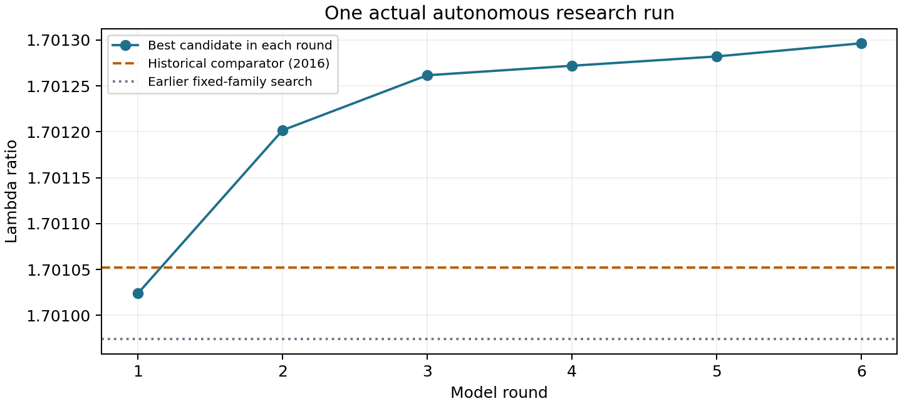

# LOResearch-Agent

基于 LangGraph 的研究型智能体，用于研究三维双电子球对称密度下的 Lieb–Oxford 比值。
模型提出候选密度，固定数值工具计算并检查，再将结果反馈给模型修改。

**[阅读研究报告（PDF，6页）](report.pdf)** · **[全部24个候选](results/audited_actual_run/candidate_results.csv)** · **[数值复核与使用说明](START_HERE_v0.5.md)**

## 研究问题

在归一化条件 $\int\rho=2$ 下，搜索较大的比值

$$\lambda[\rho]=\frac{D[\rho]-V_{\mathrm{SCE}}[\rho]}{C_x\int\rho^{4/3}},\qquad C_x=\frac34(3/\pi)^{1/3}.$$

其中 $D$ 为 Hartree 能，$V_{\mathrm{SCE}}$ 为给定密度的严格关联电子最小排斥能。
这个受限搜索是 Lieb–Oxford 最优常数问题的数值探索，不能直接确定任意电子数的普适常数。

## 实际自动运行结果

2026年10月27日，模型 `gpt-6.1-sol` 完成6轮自动模型调用、6轮工具执行、24个候选实验，耗时约83.49秒。
程序在预设调用上限处正常结束。后续请求包含前轮提议和工具反馈。

| 轮次 | 主要动作 | 本轮最好比值 |
|---|---|---:|
| 1 | 平滑边界及初步形状比较 | 1.701023977 |
| 2 | 改变负扰动位置 | 1.701201690 |
| 3 | 调整扰动强度与中心 | 1.701261606 |
| 4 | 比较扰动宽度 | 1.701271970 |
| 5 | 细化宽度，检验区域影响 | 1.701282110 |
| 6 | 增加第二项局部扰动 | **1.701296427** |



最好候选的参数见 [best_candidate.json](best_candidate.json)。
另一实现使用自适应积分与 Brent 求根，不使用生产评估器的累计密度网格和 PCHIP 插值，复核得到约 **1.70129642716652**。

## 结果边界

- 数值上超过所选2016年论文式(60)的历史比较值 `1.701052`，不宣称已核实最新纪录或数学创新。
- 未使用区间算术；多实现一致性不是严格误差包围或全局最优证明。
- 密度的有限动能可容许性不意味着奇异 SCE 最优耦合本身具有有限动能。
- 早期固定扫描与模型研究使用不同密度族和预算，不构成公平的算法优越性比较。
- 当前自动循环使用随包文献笔记，尚未实现自主联网阅读论文、形式化证明或无限期自主研究。

## 复现现有结果：不调用模型

使用 Python 3.10+。可以在 Python 编辑器中依次运行以下文件，无需打开终端：

1. `install_dependencies.py`：安装依赖。
2. `08_verify_best_candidate.py`：独立复核最好候选。
3. `09_audit_actual_run.py`：检查原始日志、重算并生成审计表和图。

也可以使用命令行：

```bash
git clone https://github.com/Baelse1/LOResearch-Agent.git
cd LOResearch-Agent
python -m pip install -r requirements.txt
python independent_verify.py
python audit_run.py
```

`build_actual_run_report.py` 可根据审计结果重新生成报告。测试版本见 `requirements-tested.txt`；它不是所有平台唯一可用的版本组合。

## 发起新的自动研究

1. 运行 `05_chatgpt_login.py`，在官方页面审阅授权。
2. 在窗口中选择并保存账号实际可用的模型。
3. 运行 `06_run_chatgpt_agent.py`，最多发起6次模型请求。

该入口使用获得授权的 ChatGPT 计划额度，不需要填写 API Key；账号资格、模型和额度以服务返回为准。
研究提示和计算结果会发送给所选模型服务。新运行不是从现有最佳候选自动续跑。
原 API Key 接口入口 `04_run_live_agent.py` 作为可选实现保留，使用时可能另行收费。

## 证据与文件

| 文件或目录 | 内容 |
|---|---|
| [report.pdf](report.pdf) | 本次实际运行与复核报告 |
| `density_tools.py` | 固定密度评估与检查工具 |
| `research_agent.py` | LangGraph 模型—工具反馈循环 |
| `chatgpt_auth.py` / `chatgpt_provider.py` | 官方授权与 Responses 接口 |
| `independent_verify.py` | 独立积分和反演实现 |
| [原始运行日志](results/actual_chatgpt_run_20261027/trace.jsonl) | 逐轮模型公开响应和工具结果 |
| [最终状态](results/actual_chatgpt_run_20261027/final_state.json) | 本次自动运行的最终记录 |
| [审计汇总](results/audited_actual_run/audit_summary.json) | 一致性校验、用量和复核结果 |
| `baselines/` | 早期数值基线和固定扫描 |
| `proposals/` | 早期会话辅助实验，不能混同于本次自动运行 |

日志哈希链用于改动检测，不是模型服务的外部签名认证。服务报告合计42608 token，本项目不据此推算货币费用。
`07_run_chatgpt_offline_test.py` 与 `test_integrations.py` 使用模拟数据，测试通过不能代替真实账号授权证据。

旧阶段PDF和说明为历史材料；当前结果以根目录报告及实际运行审计为准。

## 凭证

不要提交 `.env`、浏览器登录数据或项目外的本机凭证目录。本仓库仅包含 `.env.example`。
浏览器上传不会替你按 `.gitignore` 筛选本机文件，上传时也需要检查所选文件。

## 参考文献

1. Seidl M., Vuckovic S., Gori-Giorgi P. *Challenging the Lieb–Oxford bound in a systematic way*. Molecular Physics 114 (2016), 1076–1085. [DOI](https://doi.org/10.1080/00268976.2015.1136440)。历史比较值见式(60)。
2. Lewin M., Lieb E. H., Seiringer R. *Improved Lieb–Oxford bound on the indirect and exchange energies*. Letters in Mathematical Physics 112 (2022), 92. [DOI](https://doi.org/10.1007/s11005-022-01584-5)。
